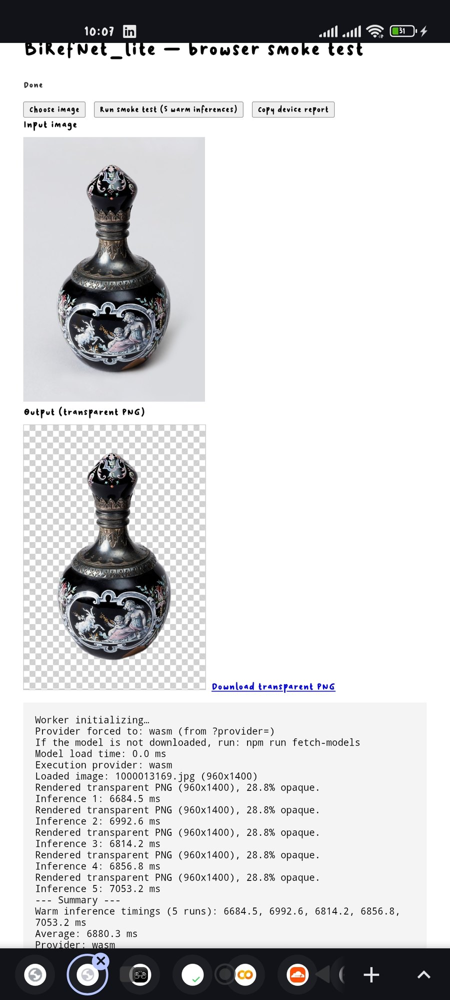

# remove-bg-photo

Browser-first background remover for product/marketplace photos. The BiRefNet
segmentation model runs **inside the user's browser** (ONNX Runtime Web via a
Web Worker); no image pixels leave the device.

> Phase 1 status. This build is the Phase 1 feasibility harness per
> `MVP_OPENHANDS.md` §13 (implement only Phase 0 + Phase 1). The verdict and
> measured results are in [`PHASE1_REPORT.md`](./PHASE1_REPORT.md).

## Result — WASM path on a real phone



Android phone (Chrome 155, mobile UA), `provider=wasm`: 960×1400 input →
transparent PNG, 28.8% opaque, **6880 ms average over 5 warm inferences**.
The same page on the same phone with `provider=webgpu` (Adreno-6xx) was **not
faster** (≈6.6–6.7 s warm) and **mis-segmented the subject** (opaque rails left
on the object), while WASM was clean in every run. So WebGPU is now **opt-in by
default**: WASM is used unless an adapter has passed validation (the
allowlist is currently empty — see the laptop WebGPU test in `PHASE1_REPORT.md`
§10 and the device plan in `HARDWARE_TESTING.md` §2), and `?provider=webgpu`
still forces the GPU path. Evidence recorded in
`HARDWARE_TESTING.md` §4 and `smoke-results/device-phone-adreno-6xx/`.

## What works (Phase 1)

- Model download + self-hosted serving (`fetch-models` verifies SHA-256).
- **Persistent model loading:** a service worker (`public/sw.js`) stores the
  model and the ONNX Runtime WASM binaries in the Cache API, so only the first
  visit downloads them. Later visits (including after closing the tab or
  restarting the browser) load from the device instead of re-fetching ~235 MB.
- ONNX Runtime Web (1.29.0) inference on **WASM (threaded) by default**, with
  **WebGPU** enabled only on validated adapters (currently none) or via
  `?provider=webgpu`.
- Minimal page + Worker pre/post-processing: mask upscale to original
  dimensions, alpha composite, transparent PNG export.
- Headless smoke harness (`run-smoke.mjs`) that records every network request
  (privacy check) and downloads the resulting PNG.
- Native-CPU reference inference (`reference-inference.py`) that produces the
  same model's masks fast, for correctness cross-checks.

## Requirements

- Node.js ≥ 20 (tested on v24)
- System Chromium for the headless smoke test (`/usr/bin/chromium`; override with `CHROME_BIN`)
- Python 3 + `pip` (only for the optional reference-inference script)
- A GPU with WebGPU is strongly recommended (see latency notes in `PHASE1_REPORT.md`)

## Setup

```bash
npm install
npm run fetch-models   # downloads model + WASM into public/ with SHA-256 checks
npm run dev            # http://localhost:12000 (dev:local keeps the Vite default 5173)
```

Open the URL the dev server prints, not `index.html` itself: the page needs Vite
to compile `src/main.ts`, so opening the file directly (or through an editor's
file preview) renders a page that cannot start. On a remote sandbox, use the
https URL that forwards port 12000.

## Persistent model loading

The model (`model_512.onnx`, ~185 MB) and the ONNX Runtime WASM binaries
(~42 MB) are large enough that re-downloading them on every visit is the dominant
cost of using the app. A service worker (`public/sw.js`) fixes that:

- On the first visit, `/models/*` and `/wasm/*` are fetched from the network and
  stored in a versioned Cache API bucket (`remove-bg-assets-<version>`).
- On every later visit the service worker serves them cache-first, so the model
  loads from the device. This survives closing the tab and restarting the
  browser (subject to the browser's normal storage-eviction rules).
- The page waits for the service worker to control it *before* starting the
  inference worker, so the worker's own fetches are cached on the first visit
  too. If the worker cannot take control within 5 s, the app still starts (a
  cache miss is a performance problem, not a correctness one).
- The page log reports `Asset cache ready (N artifact(s) already on this
  device)` and lists what was newly cached.
- The load is reported as named checkpoints (see below), so the UI says what is
  happening rather than only a percentage.

### Loading checkpoints

The worker emits a `loading-progress` message at each milestone, and the page
renders it on the stage line and logs each stage once. The stages are:

`queued` → `runtime` → `cache-check` → `downloading` → `downloaded` →
`creating-session` → `session-ready` → `ready`

Each message carries a monotonic `percent`, the bytes transferred and expected
total (while downloading), and the elapsed time since loading began, so the UI
can show e.g. `Downloading model… 42% (78.1 MB / 185.0 MB, 12.3s)`. On a cached
visit the whole load takes ~1–2 s instead of the first-visit download time.

To force a re-download after changing the model or upgrading ONNX Runtime, bump
`CACHE_VERSION` in `public/sw.js`. For hosts that honor it, `public/_headers`
(Cloudflare Pages syntax) also sets `Cache-Control: immutable` on `/models/*`
and `/wasm/*` as a second layer for browsers where a service worker is
unavailable.

## Browser smoke test (headless)

```bash
# model load + 1 inference + transparency PNG + network request log
node scripts/run-smoke.mjs "http://localhost:5173/" \
  --image test-images/glass-wine.jpg --runs 1 --out smoke-results-final
```

Outputs to `--out`:
- `output.png` — transparent PNG (result of the pipeline)
- `requests.json` — every network request made during processing (privacy: must all be first-party)
- `summary.json` — provider, timings, page log

## Reference inference (native CPU, fast)

```bash
pip install pillow numpy onnxruntime
python3 scripts/reference-inference.py                # default: the 3 test images
python3 scripts/reference-inference.py test-images/glass-wine.jpg
# outputs smoke-results/reference/*.mask.png + summary.json (~12 s/image, vs >10 min WASM)
```

## Commands

| Command | Purpose |
|---|---|
| `npm run dev` | Vite dev server on port 12000 (the port remote sandboxes forward) |
| `npm run dev:local` | Vite dev server on its default port 5173 |
| `npm run build` | typecheck + production build |
| `npm run typecheck` | `tsc --noEmit` |
| `npm run fetch-models` | download + verify model/WASM artifacts (also prepares `public/wasm/` for local dev) |
| `node scripts/run-smoke.mjs <url> [--image …] [--runs n] [--out dir]` | headless browser smoke test |

## Deployment

There is no automated deploy pipeline in this repository anymore (the previous
Cloudflare Pages pipeline was removed after its worker was deleted). The app is
a static site where the app shell comes from any static host and the heavy
artifacts (model + WASM runtime) are fetched and cached at runtime — see
[`DEPLOY.md`](./DEPLOY.md) for the architecture and how to re-enable a deploy
if you want one.

## Privacy

- Processing happens entirely in the browser. See [`PRIVACY.md`](./PRIVACY.md).
- The smoke harness records all network requests; verification results are in
  `PHASE1_REPORT.md` and `smoke-results-final/requests.json`.

## Licensing / notices

- [`THIRD_PARTY_LEGAL_NOTICES.md`](./THIRD_PARTY_LEGAL_NOTICES.md) — Phase-1
  provenance + hashes; full licence audit pending Phase 3.
- [`MODEL_CARD.md`](./MODEL_CARD.md) — model provenance and semantics.

## Known Phase-1 limitations

- Input resolution is the dominant memory cost, and it is fixed per export.
  The original 1024×1024 export peaked at ~1.5 GB of transient activation memory
  in native CPU inference (largest single tensor 411 MB), and its graph
  hard-codes 1024 via `Split`/`Resize` constants, so it cannot be fed a smaller
  image. That exceeded both the browser's WASM heap and the GPU memory of the
  target devices, failing inside `OrtRun()` with `ERROR_CODE: 6 … std::bad_alloc`.
  The shipped model is therefore the same official `BiRefNet_lite` backbone
  exported at a fixed 512×512 input, which peaks at ~1.1 GB and runs on both
  WebGPU and WASM.
- **Known quality limitation (measured):** the 512 input reproduces the 1024
  mask at IoU 0.992 with sub-1/255 mean difference, but its edge is genuinely
  softer — the transition band at the subject boundary is ~1.5–1.8× wider
  (≈2.4 px vs ≈1.4 px). The difference is edge-localised and most visible on
  specular/glass detail (a wine-glass rim reads slightly softer and fainter);
  product and fur silhouettes are visually equivalent. This is an accepted
  trade-off, not a defect. Note that an earlier edge-sharpness metric reported
  the opposite direction; that was a grid-sampling artifact, corrected in
  `COLAB_T4_REPORT.md` §5.
- WASM/CPU inference on the 512×512 export takes roughly 3–6 s per image
  (native CPU ~2.2 s), so the CPU path is usable rather than a last resort.
- A quantised variant was evaluated and rejected: dynamic int8 shrank the file
  by only 12% and ran 2.3× slower, because Conv dominates and its kernels stay
  float. fp16 weights ran ~2× slower on CPU for the same reason.
- Mitigations in place: WASM is the default provider, the high-performance GPU
  adapter is requested for opt-in WebGPU, and a WebGPU failure automatically
  rebuilds the session on the WASM provider and reports the fallback in the log.
- WebGPU is **disabled by default** until an adapter is validated. `navigator.gpu`
  existing is not enough — an unvalidated driver can silently return a wrong
  mask (observed on Adreno-6xx), which the WASM fallback would never catch.
  The allowlist lives in `public/inference-worker.js`
  (`VALIDATED_WEBGPU_SUBSTRINGS`) and in
  `src/features/background-removal/model.worker.ts`; validate an adapter
  end-to-end (correct mask + acceptable latency) before adding it.
  `?provider=webgpu` forces WebGPU regardless of the allowlist.
- WebGPU runs are bounded by a watchdog: 180 s for the first run (it compiles
  shaders) and 120 s afterwards. A run that never settles would otherwise leave
  the UI with no output and no error. On timeout the run falls back to WASM.
  WASM runs are deliberately unbounded — they are slow, not stalled.
- The shipped model is float32 internally, so WebGPU no longer depends on the
  adapter's `shader-f16` feature (fp16 emulation was the cause of the Intel
  Gen-9 stalls). The log still reports `shader-f16=yes|no` for the chosen
  adapter, since other model builds may require it.
- `?provider=wasm` and `?provider=webgpu` force a specific backend. Use
  `?provider=wasm` to rule the GPU out when diagnosing a stall, and
  `?provider=webgpu` to opt into the GPU on an adapter that is not on the
  validated list yet (or to pre-validate one). The default (no flag) is WASM.
- The full product UI (Phase 2), legal docs (Phase 3), and test suite (Phase 4)
  are not built yet per the Phase-1 prompt.
