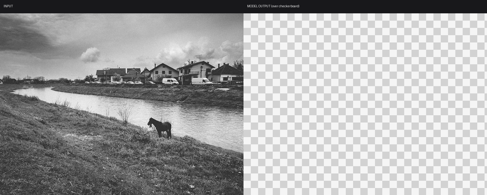
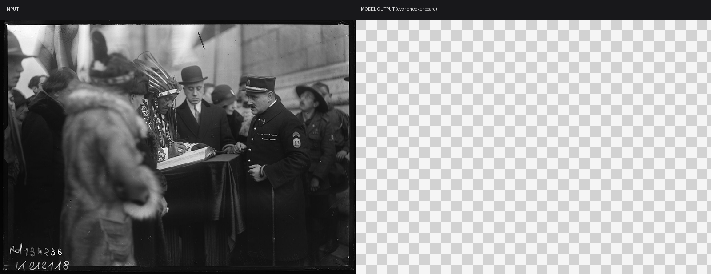
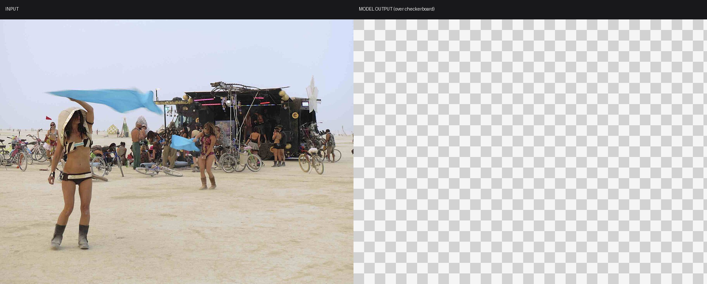
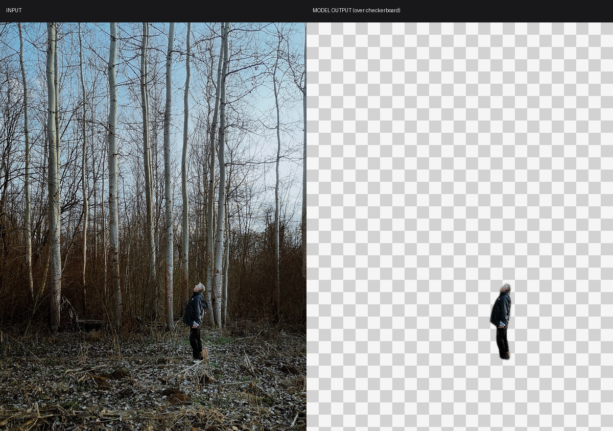
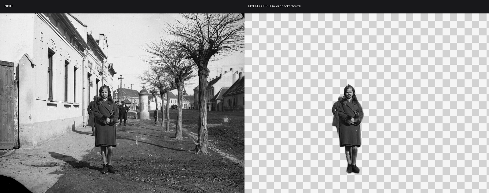
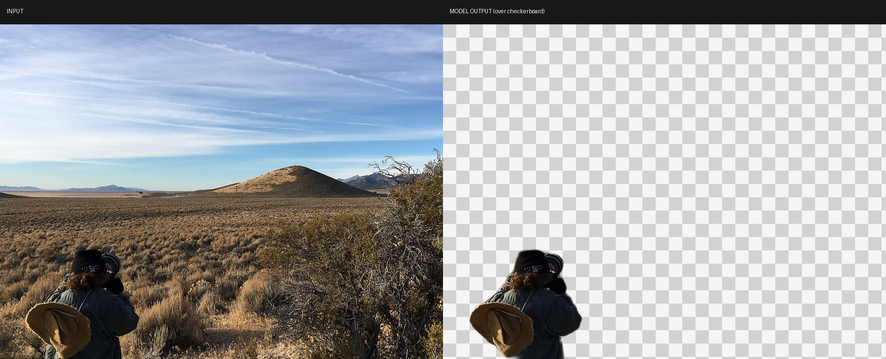
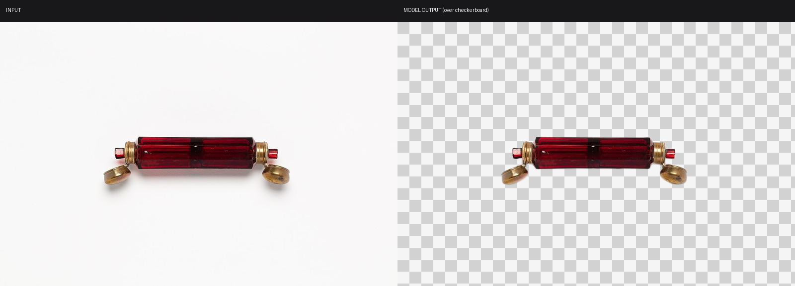
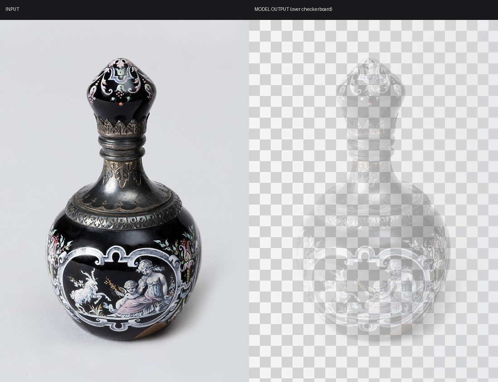

# Failed-inference gallery

Real, reproducible examples of unsuccessful background removal, kept so the failures can be inspected, classified, compared and reproduced. Each case is a folder under `cases/` holding the input, the model's cut-out, the cut-out over a checkerboard, a side-by-side comparison, and a `metadata.json` record.

Cases 1–8 were produced by running the **shipped model** (`qmix-cut-512`, `models/model_512_int8_fp16.onnx`) through the real product pipeline — letterbox preprocess → ONNX artefact → crop the padding → bilinear upscale to the original size → alpha. The offline CPU path (ONNX Runtime) reproduces the browser path exactly, so these are genuine model failures, not mock-ups. Case 9 is the one real-device failure that cannot run here (it needs an Adreno-6xx GPU); its assets are a **synthetic reconstruction** of the documented signature and are labelled as such.

## Reproduce

```bash
python3 -m pip install onnxruntime pillow numpy
# the shipped artefact (sha256 10f1cf12…)
curl -L -o /tmp/model.onnx \
  https://huggingface.co/spaces/Octoborg/remove-photo-bg/resolve/main/models/model_512_int8_fp16.onnx
python3 scripts/eval/build-failure-gallery.py --model /tmp/model.onnx
```

Regenerating rewrites every case folder and the manifest/summary below, so the JSON, this document and the images always agree.

## Summary

- **Total cases:** 9
- **Confirmed failures:** 6 (failure-001, failure-002, failure-003, failure-004, failure-005, failure-009)
- **Borderline cases:** 3 (failure-006, failure-007, failure-008)
- **Fixed vs unresolved:** 0 fixed, 9 unresolved, 0 pass after a fix
- **Synthetic (not a live capture):** 1

**Failures by category**

| key | cases |
|---|---|
| empty-output | 4 |
| partial-subject-removal | 3 |
| near-empty-output | 1 |
| washed-out-ghost | 1 |

**Failures by provider**

| key | cases |
|---|---|
| wasm | 8 |
| webgpu | 1 |

**Failures by model**

| key | cases |
|---|---|
| qmix-cut-512 | 9 |

**Failures by severity**

| key | cases |
|---|---|
| high | 6 |
| medium | 3 |

## Cases

### failure-001 — empty-output (high)



| Field | Value |
|---|---|
| Case ID | `failure-001` |
| Original image | `eval/images/hair-fur-07.jpg` — [File:Black and white picture of a horse on a river bank. Houses and vehicles in the background (51151104640).jpg](https://commons.wikimedia.org/wiki/File:Black_and_white_picture_of_a_horse_on_a_river_bank._Houses_and_vehicles_in_the_background_(51151104640).jpg) |
| Input size | 1280×959 |
| Inference result | `empty` — foreground 0.0000, alpha max 0/255 |
| Failure category | `empty-output` |
| Severity | `high` |
| Model | `qmix-cut-512` (`models/model_512_int8_fp16.onnx`) |
| Provider | `wasm` |
| Reproduction status | `reproduced` |
| Observed problem | The model returned a fully transparent mask: nothing of the subject survives. Every pixel is alpha 0. |
| Suspected cause | A black-and-white, low-contrast frame (a pale horse on a pale river bank). With no colour cue and little luminance separation between subject and background, the model finds no confident foreground. |
| Tested: Raw model output | min 0.000 / mean 0.000 / max 0.000 — a hard zero, not a low-confidence mask. |
| Tested: Model precision | The fp16 variant (model_512_int0_fp16.onnx) also returns empty, so this is not an int8 quantisation artefact. |
| Tested: Input contrast stretch | Per-channel histogram stretch before inference leaves the mask max unchanged. |
| Tested: 2x2 tiled inference | All four tiles return exactly 0.000 — a closer view does not help. |
| Tested: Post-inference knobs | Threshold, feather and the refinement config all operate on a zero mask and cannot raise it. |
| Fix implemented | no |
| Passes after fix | n/a — no fix |

Assets: [`input.png`](cases/failure-001/input.png) · [`output.png`](cases/failure-001/output.png) · [`output-checkerboard.png`](cases/failure-001/output-checkerboard.png) · [`comparison.png`](cases/failure-001/comparison.png) · [`metadata.json`](cases/failure-001/metadata.json)

### failure-002 — empty-output (high)



| Field | Value |
|---|---|
| Case ID | `failure-002` |
| Original image | `eval/images/hair-fur-08.jpg` — [File:Le Horse White Eagle (i.e. White Horse Eagle, chef amérindien Sioux de 107 ans) au Soldat inconnu, 13-12-28 - btv1b532075002.jpg](https://commons.wikimedia.org/wiki/File:Le_Horse_White_Eagle_(i.e._White_Horse_Eagle,_chef_am%C3%A9rindien_Sioux_de_107_ans)_au_Soldat_inconnu,_13-12-28_-_btv1b532075002.jpg) |
| Input size | 1280×917 |
| Inference result | `empty` — foreground 0.0000, alpha max 0/255 |
| Failure category | `empty-output` |
| Severity | `high` |
| Model | `qmix-cut-512` (`models/model_512_int8_fp16.onnx`) |
| Provider | `wasm` |
| Reproduction status | `reproduced` |
| Observed problem | Fully transparent output. The subject is removed entirely. |
| Suspected cause | A very dark, historic black-and-white photograph (mean luminance 68/255). The subject is barely separated from an almost-black background, so the mask collapses to empty. |
| Tested: Raw model output | min 0.000 / mean 0.00001 / max 0.00005 — effectively a hard zero. |
| Tested: Model precision | fp16 also empty — not a quantisation artefact. |
| Tested: Input contrast stretch | No effect on the mask max. |
| Tested: 2x2 tiled inference | All four tiles return exactly 0.000. |
| Tested: Post-inference knobs | Cannot raise a zero mask. |
| Fix implemented | no |
| Passes after fix | n/a — no fix |

Assets: [`input.png`](cases/failure-002/input.png) · [`output.png`](cases/failure-002/output.png) · [`output-checkerboard.png`](cases/failure-002/output-checkerboard.png) · [`comparison.png`](cases/failure-002/comparison.png) · [`metadata.json`](cases/failure-002/metadata.json)

### failure-003 — empty-output (high)



| Field | Value |
|---|---|
| Case ID | `failure-003` |
| Original image | `eval/images/complex-bg-05.jpg` — [File:Burning Man 2013 Dance Party in Deep Playa (10226923844).jpg](https://commons.wikimedia.org/wiki/File:Burning_Man_2013_Dance_Party_in_Deep_Playa_(10226923844).jpg) |
| Input size | 1280×960 |
| Inference result | `empty` — foreground 0.0000, alpha max 0/255 |
| Failure category | `empty-output` |
| Severity | `high` |
| Model | `qmix-cut-512` (`models/model_512_int8_fp16.onnx`) |
| Provider | `wasm` |
| Reproduction status | `reproduced` |
| Observed problem | Fully transparent output against a cluttered, multi-subject background. |
| Suspected cause | A crowded night scene with no single dominant subject. The model has no clear figure to latch onto and returns an empty mask. |
| Tested: Raw model output | min 0.000 / mean 0.00001 / max 0.00006 — effectively a hard zero. |
| Tested: Model precision | fp16 also empty — not a quantisation artefact. |
| Tested: Input contrast stretch | No effect on the mask max. |
| Tested: 2x2 tiled inference | All four tiles return exactly 0.000. |
| Tested: Post-inference knobs | Cannot raise a zero mask. |
| Fix implemented | no |
| Passes after fix | n/a — no fix |

Assets: [`input.png`](cases/failure-003/input.png) · [`output.png`](cases/failure-003/output.png) · [`output-checkerboard.png`](cases/failure-003/output-checkerboard.png) · [`comparison.png`](cases/failure-003/comparison.png) · [`metadata.json`](cases/failure-003/metadata.json)

### failure-004 — empty-output (high)


| Field | Value |
|---|---|
| Case ID | `failure-004` |
| Original image | `eval/images/thin-structure-04.jpg` — [File:Close-up of a wooden cutlery tray. Forks, spoons and knives.jpg](https://commons.wikimedia.org/wiki/File:Close-up_of_a_wooden_cutlery_tray._Forks,_spoons_and_knives.jpg) |
| Input size | 1280×854 |
| Inference result | `empty` — foreground 0.0000, alpha max 0/255 |
| Failure category | `empty-output` |
| Severity | `high` |
| Model | `qmix-cut-512` (`models/model_512_int8_fp16.onnx`) |
| Provider | `wasm` |
| Reproduction status | `reproduced` |
| Observed problem | Fully transparent output for a close-up of cutlery in a tray. |
| Suspected cause | Thin metal structures with specular highlights and very low foreground area, in a dark wooden tray. Thin, low-area subjects are the documented hardest class for this model. |
| Tested: Raw model output | min 0.000 / mean 0.000 / max 0.000 — a hard zero. |
| Tested: Model precision | fp16 also empty — not a quantisation artefact. |
| Tested: Input contrast stretch | No effect on the mask max. |
| Tested: 2x2 tiled inference | MEASURED FALSE POSITIVE — do not ship this. Three of the four tiles return exactly 0.000; the fourth floods (fg 0.794, median 0.992) instead of detecting anything. The stitched mask equals that single tile's mask multiplied by its crossfade weight field (max abs error 0.00000, correlation 1.00000), so it encodes the TILE GEOMETRY, not the image: IoU against the metal cutlery is 0.11 and it keeps 13.5% of the dark tray background. Its boundary gradient contrast is 1.75, versus 8.7–15.0 for real cut-outs. Scores REVIEW instead of FAIL(empty) only because a mask exists. |
| Tested: Post-inference knobs | Cannot raise a zero mask. |
| Fix implemented | no |
| Passes after fix | n/a — no fix |

Assets: [`input.png`](cases/failure-004/input.png) · [`output.png`](cases/failure-004/output.png) · [`output-checkerboard.png`](cases/failure-004/output-checkerboard.png) · [`comparison.png`](cases/failure-004/comparison.png) · [`metadata.json`](cases/failure-004/metadata.json)

### failure-005 — near-empty-output (high)



| Field | Value |
|---|---|
| Case ID | `failure-005` |
| Original image | `eval/images/complex-bg-07.jpg` — [File:Man standing in a tall tree forest (49488603843).jpg](https://commons.wikimedia.org/wiki/File:Man_standing_in_a_tall_tree_forest_(49488603843).jpg) |
| Input size | 1280×1707 |
| Inference result | `ok` — foreground 0.0077, alpha max 255/255 |
| Failure category | `near-empty-output` |
| Severity | `high` |
| Model | `qmix-cut-512` (`models/model_512_int8_fp16.onnx`) |
| Provider | `wasm` |
| Reproduction status | `reproduced` |
| Observed problem | Near-empty output: only 0.77% of pixels are kept, so the subject (a person in a forest) is almost entirely removed. |
| Suspected cause | The subject is a small, low-contrast figure against a tall-tree forest, a background with strong vertical texture that the model prefers over the thin human figure. |
| Fix implemented | no |
| Passes after fix | n/a — no fix |

Assets: [`input.png`](cases/failure-005/input.png) · [`output.png`](cases/failure-005/output.png) · [`output-checkerboard.png`](cases/failure-005/output-checkerboard.png) · [`comparison.png`](cases/failure-005/comparison.png) · [`metadata.json`](cases/failure-005/metadata.json)

### failure-006 — partial-subject-removal (medium)



| Field | Value |
|---|---|
| Case ID | `failure-006` |
| Original image | `eval/images/accessory-07.jpg` — [File:Ad pillar, street view, portrait, lady, handbag Fortepan 52840.jpg](https://commons.wikimedia.org/wiki/File:Ad_pillar,_street_view,_portrait,_lady,_handbag_Fortepan_52840.jpg) |
| Input size | 1280×940 |
| Inference result | `ok` — foreground 0.0378, alpha max 254/255 |
| Failure category | `partial-subject-removal` |
| Severity | `medium` |
| Model | `qmix-cut-512` (`models/model_512_int8_fp16.onnx`) |
| Provider | `wasm` |
| Reproduction status | `reproduced` |
| Observed problem | Borderline: only 3.8% of pixels are kept. Much of the subject is removed; a small fragment survives. |
| Suspected cause | A street-scene advertisement pillar with several figures; the model keeps one small region and discards the rest. |
| Fix implemented | no |
| Passes after fix | n/a — no fix |

Assets: [`input.png`](cases/failure-006/input.png) · [`output.png`](cases/failure-006/output.png) · [`output-checkerboard.png`](cases/failure-006/output-checkerboard.png) · [`comparison.png`](cases/failure-006/comparison.png) · [`metadata.json`](cases/failure-006/metadata.json)

### failure-007 — partial-subject-removal (medium)



| Field | Value |
|---|---|
| Case ID | `failure-007` |
| Original image | `eval/images/hair-fur-06.jpg` — [File:2020 Seaman and White River Herd Areas Wild Horse Gather (49057019778).jpg](https://commons.wikimedia.org/wiki/File:2020_Seaman_and_White_River_Herd_Areas_Wild_Horse_Gather_(49057019778).jpg) |
| Input size | 1280×967 |
| Inference result | `ok` — foreground 0.0534, alpha max 254/255 |
| Failure category | `partial-subject-removal` |
| Severity | `medium` |
| Model | `qmix-cut-512` (`models/model_512_int8_fp16.onnx`) |
| Provider | `wasm` |
| Reproduction status | `reproduced` |
| Observed problem | Borderline: 5.3% of pixels kept. The main subject is largely removed, leaving only fragments. |
| Suspected cause | A herd of wild horses in a dusty, low-contrast setting; the animals blend into the background. |
| Fix implemented | no |
| Passes after fix | n/a — no fix |

Assets: [`input.png`](cases/failure-007/input.png) · [`output.png`](cases/failure-007/output.png) · [`output-checkerboard.png`](cases/failure-007/output-checkerboard.png) · [`comparison.png`](cases/failure-007/comparison.png) · [`metadata.json`](cases/failure-007/metadata.json)

### failure-008 — partial-subject-removal (medium)



| Field | Value |
|---|---|
| Case ID | `failure-008` |
| Original image | `eval/images/glass-transparent-06.jpg` — [File:Bottle, scent (51359099367).jpg](https://commons.wikimedia.org/wiki/File:Bottle,_scent_(51359099367).jpg) |
| Input size | 1280×853 |
| Inference result | `ok` — foreground 0.0501, alpha max 255/255 |
| Failure category | `partial-subject-removal` |
| Severity | `medium` |
| Model | `qmix-cut-512` (`models/model_512_int8_fp16.onnx`) |
| Provider | `wasm` |
| Reproduction status | `reproduced` |
| Observed problem | Borderline: 5.0% of pixels kept for a scent bottle. Most of the subject is removed. |
| Suspected cause | A small, translucent glass bottle; transparent subjects have little solid area for the model to lock onto. |
| Fix implemented | no |
| Passes after fix | n/a — no fix |

Assets: [`input.png`](cases/failure-008/input.png) · [`output.png`](cases/failure-008/output.png) · [`output-checkerboard.png`](cases/failure-008/output-checkerboard.png) · [`comparison.png`](cases/failure-008/comparison.png) · [`metadata.json`](cases/failure-008/metadata.json)

### failure-009 — washed-out-ghost (high)



| Field | Value |
|---|---|
| Case ID | `failure-009` |
| Original image | `test-images/product-scent-bottle.jpg` — [None](None) |
| Input size | 960×1400 |
| Inference result | `washed` — foreground 0.0000, alpha max 105/255 |
| Failure category | `washed-out-ghost` |
| Severity | `high` |
| Model | `qmix-cut-512` (`models/model_512_int8_fp16.onnx`) |
| Provider | `webgpu` on Qualcomm Adreno-6xx (Android 10, Chrome 157) |
| Reproduction status | `not-reproduced-locally (needs Adreno-6xx hardware)` |
| Observed problem | The whole frame came out faint and translucent — a washed-out "ghost" — with no opaque foreground core (max alpha 0.41, mean 0.23), yet the photo visible everywhere at ~23% opacity. |
| Suspected cause | On a Qualcomm Adreno-6xx phone the WebGPU kernel returned a flat, low-confidence mask with no confident foreground (the documented driver/precision hypothesis in HARDWARE_TESTING.md §1/§8). The same flat shape appears whether or not a fallback ran, so it is the GPU kernel output itself, not the repo's alpha path. |
| Fix implemented | no |
| Passes after fix | n/a — no fix |

Assets: [`input.png`](cases/failure-009/input.png) · [`output.png`](cases/failure-009/output.png) · [`output-checkerboard.png`](cases/failure-009/output-checkerboard.png) · [`comparison.png`](cases/failure-009/comparison.png) · [`metadata.json`](cases/failure-009/metadata.json)

## How a failure is classified

| Category | Meaning |
|---|---|
| `empty-output` | The model returned a fully transparent mask (alpha max 0). |
| `near-empty-output` | A mask exists but keeps almost nothing (<1% of pixels). |
| `partial-subject-removal` | Only a small fragment of the subject survives (1–10%). |
| `washed-out-ghost` | The whole frame is faint and translucent, with no opaque core. |

Severity: `high` for a confirmed failure (the subject is lost or the frame is unusable), `medium` for a borderline case (most of the subject is lost but a fragment survives).
